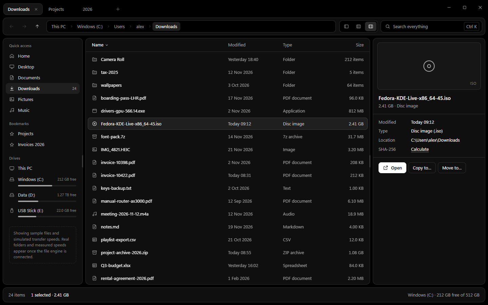

# Slate

A lightweight file explorer for Windows and Linux. It does what you use Windows Explorer for every day, with a quieter black, white and grey interface and an engine built to be fast where Explorer feels slow: **searching** and **copying**.



## Install

Download the latest installer from [Releases](../../releases):

| System | File |
| --- | --- |
| Windows 10/11 | `Slate_x.y.z_x64-setup.exe` (per-user, no admin) or `Slate_x.y.z_x64_en-US.msi` |
| Fedora (tested target: Fedora 45 KDE Plasma) | `Slate-x.y.z-1.x86_64.rpm`, then `sudo dnf install ./Slate-*.rpm` |
| Debian / Ubuntu | `slate_x.y.z_amd64.deb` |
| Any Linux | `slate_x.y.z_amd64.AppImage` (`chmod +x` and run) |

On Linux, Slate uses the system WebKitGTK 4.1, which `dnf` pulls in automatically.

## What it does

**Everyday Explorer features**
- Tabs, back/forward/up, a clickable breadcrumb (Ctrl+L to type a path) and a sidebar with Quick access, bookmarks and drives.
- Details view with sortable columns. Multi-select with Ctrl, Shift and type-to-select.
- Copy, cut, paste, drag and drop, Copy to… and Move to….
- Rename (F2), new folder (Ctrl+Shift+N), delete to the Recycle Bin or Trash, and permanent delete (Shift+Del).
- Open with the default app, a preview panel and a hidden-files toggle (Ctrl+H).

**Faster where it matters**
- **Instant search (Ctrl+K).** At startup Slate builds an in-memory index of every filename (all drives on Windows; your home folder and mounted media on Linux), so results appear as you type, usually in a few milliseconds.
- **Copy engine.**
  - Moves on the same drive are a rename, so they finish instantly.
  - Small files copy in parallel on 8 workers using the OS's native copy (CopyFileExW on Windows; `copy_file_range` on Linux, which makes instant reflink copies on Fedora's default btrfs).
  - Large files stream in big chunks.
  - Progress starts immediately: there's no slow "calculating" phase.
- **Fit check before you copy.** Copy to… shows whether the files will fit on each destination before you start.

**Extras**
- Dual-pane mode (Ctrl+2) and a preview layout (Ctrl+3). Panels glide between layouts, and the splitters resize and remember their widths.
- Command palette (Ctrl+K) for files, folders and actions.
- Batch rename: name and number, find and replace, or change case, with a live preview.
- Undo (Ctrl+Z) for delete, rename, batch rename, copy, move and new folder.
- Folder sizes, and a duplicate finder that compares file contents with SHA-256.
- SHA-256 checksums for downloads such as ISOs and installers.
- Column filters, like Explorer's: open the arrow on any column header to show only certain types, dates (Today, Last week…), sizes (Tiny, Large…) or names.
- Views like Explorer's (the View button, Ctrl+Shift+1–4, or Ctrl+scroll): Details, Tiles, Medium icons and Large icons. On Windows the icon views show real thumbnails of photos, videos and PDFs.
- Windows file icons (switch to Slate's own monochrome icons in Settings).
- Settings (the gear, or Ctrl+,): start folder, single or double click, hidden files, file extensions, folders first, delete confirmation, row spacing, date style, animations, updates and the search index.

## Make Slate your default file explorer

Open **Settings** (the gear, or Ctrl+,) and turn on **Default file explorer**. It's also in Ctrl+K.

- **Windows:** double-clicking folders and drives, and pressing **Win+E**, now opens Slate. Folders open as a new tab in the window that's already running. Only per-user registry keys under `HKCU\Software\Classes` change, and Explorer itself is untouched.
- **Fedora KDE / Linux:** Slate becomes the handler for folders (`inode/directory`), the same setting as KDE's *Default Applications → File Manager*.

To switch back, turn the setting off, or press Ctrl+K and choose **Restore Windows Explorer as default** (on Linux, *Restore the previous file manager as default*).

## Experimental: Slate as the Open and Save dialog (Windows)

Settings has an opt-in switch, **Use Slate for Open and Save dialogs**. When it's on, the Browse, Open and Save buttons in other apps show Slate instead of the Windows dialog.

**This is risky; it's off by default for that reason.**

- It works by registering a small component (`dialog/`) as the per-user provider of the Windows file dialogs. Every app's Open and Save then goes through it, so a bug could make other apps crash or fail to save.
- Antivirus software may flag or block it, because malware uses the same Windows mechanism.
- Apps running as administrator, Microsoft Store apps and some older apps keep the Windows dialog. So do apps that add their own controls to the dialog, apps that filter what it shows, and any time Slate can't be reached.
- Hold **Shift** while a dialog opens to get the Windows one.

To undo it by hand (for example if Slate won't start), run in PowerShell:

```powershell
reg delete "HKCU\Software\Classes\CLSID\{DC1C5A9C-E88A-4dde-A5A1-60F82A20AEF7}" /f; reg delete "HKCU\Software\Classes\CLSID\{C0B4E2F3-BA21-4773-8DBA-335EC946EB8B}" /f; reg delete "HKCU\Software\Classes\WOW6432Node\CLSID\{DC1C5A9C-E88A-4dde-A5A1-60F82A20AEF7}" /f; reg delete "HKCU\Software\Classes\WOW6432Node\CLSID\{C0B4E2F3-BA21-4773-8DBA-335EC946EB8B}" /f
```

## Keyboard

| Keys | Action |
| --- | --- |
| Ctrl+K / Ctrl+F | Search everything and run actions |
| Ctrl+T, Ctrl+W, Ctrl+Tab | New, close and next tab |
| Ctrl+1 / 2 / 3 | Single, two panes, preview layout |
| Alt+Left/Right/Up, Backspace | Back, forward, up |
| Ctrl+L | Type a location |
| F2 | Rename; with several items selected, batch rename |
| Del / Shift+Del | Recycle Bin / permanent delete |
| Ctrl+C / X / V, Ctrl+Z | Clipboard, undo |
| Ctrl+H | Show hidden files |
| Ctrl+, | Settings |
| Middle-click a folder | Open it in a new tab |
| Tab (two panes) | Switch pane |

## Build from source

You need Rust (stable), Node 18+ and the [Tauri prerequisites](https://tauri.app/start/prerequisites/): MSVC Build Tools on Windows, or `webkit2gtk4.1-devel gtk3-devel` on Fedora.

```sh
npm install
npm run dev      # run the app
npm run build    # installers in src-tauri/target/release/bundle/
npm run preview  # just the UI in a browser, on built-in sample files
```

Pushing a tag such as `v0.1.0` makes GitHub Actions build the Windows and Linux installers, check the `.rpm` installs on Fedora 45, and attach everything to a draft release.

## Project layout

```
ui/          interface (plain HTML/CSS/JS, no build step)
  fs.js      one async file API: Rust engine in the app, sample data in a browser
src-tauri/
  src/fsops.rs     listing, drives, rename, trash/restore, sizes, hashes, duplicates
  src/index.rs     the in-memory search index
  src/transfer.rs  the parallel copy/move engine
  src/icons.rs     Windows file icons
  src/picker.rs    serves Open/Save requests from the dialog component
dialog/      experimental Windows Open/Save dialog component (Rust COM DLL)
DESIGN.md    the visual system (colours, type, spacing, motion, components)
PRODUCT.md   who Slate is for and the principles behind it
```

## Known limits

- The search index refreshes every 10 minutes and on demand ("Rebuild the search index" in Ctrl+K). Files created in the meantime appear in folders straight away but not in search until the next refresh. A live file watcher is planned.
- Windows shell extensions (third-party right-click entries) and OneDrive status icons are not supported.
- On Windows, the index walks drives normally. Reading the NTFS Master File Table directly, which is faster but needs admin, is planned.

## License

MIT
